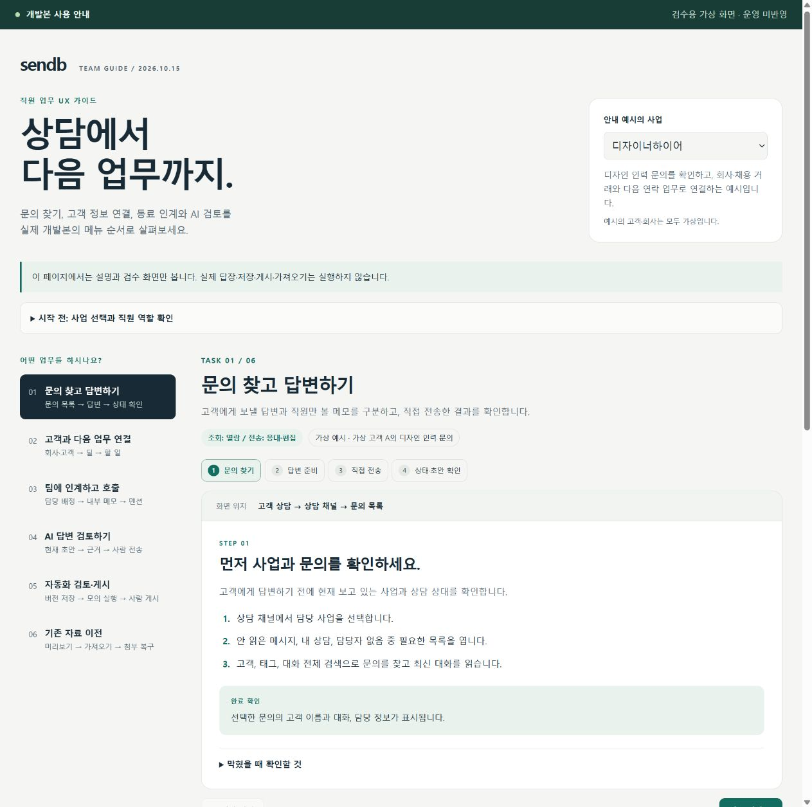

# 직원 업무 UX 가이드

**개발 검토본의 직원 사용 안내**다. 디자이너하이어·백오피스랩을 선택해 여섯 업무, 28단계를 볼 수 있다. 실제 답장·저장·게시·가져오기를 실행하지 않으며 실제 사이트 설치·자료 이전·현업 인수가 끝났다는 뜻은 아니다.

[가이드 열기](employee-ux-guide/index.html) · [근거와 검증 기록](employee-ux-guide/evidence.json)

로컬에서 `employee-ux-guide` 폴더의 `index.html`을 브라우저로 열면 동작한다. HTML·JS·CSS·가상 화면은 같은 폴더 구조로 유지한다. 외부 서비스·제품 API·DB 연결이 없으며 가이드의 버튼은 설명 이동과 이미지 확대만 처리한다. GitHub에서는 소스가 표시될 수 있다.

| 업무 | 안내 내용 |
|---|---|
| 문의 찾고 답변하기 | 사업·문의 확인, 파일/본문 준비, 직접 전송과 실패 재시도, 상태·초안 수명 |
| 고객과 다음 업무 연결 | 고객·회사, 딜, 담당 할 일, 공개 활동 타임라인과 내부 메모 구분 |
| 팀에 인계하고 동료 호출 | 팀/개인 담당, 내부 메모의 실제 멘션 대상, 앱 알림, 이어받기 |
| AI 초안 검토 | 현재 상담 생성·근거·삽입·사람 전송, 읽기 전용 병합 전 기록, 승인 설정 |
| 자동화 검토·게시 | 새 버전·모의 실행·사람 게시, 기본 꺼짐 워커, 실행 이력과 중단·복구 |
| 기존 자료 이전 | 원본 준비·미리보기·사람 실행·기본 직원 보관과 확인된 본인 공개 선택, 읽기 전용 기록·첨부 복구 |

관리자 추가 안내에는 [직원 권한](ACCESS.md), [업무시간·응대 목표·성과](OPERATIONS.md), [고객·회사 보관과 복구](CUSTOMER-RECORDS.md)의 실제 진입 방법을 덧붙였다. 기본 흐름에 없는 고급 요구를 완료로 표시하지 않는다.

과거 채널톡 기록은 관리자가 실제 원본 계정과 사이트 회원 ID 체계의 일치를 확인한 경우에만 고객 본인에게 공개 대화·공개 파일을 읽기 전용으로 제공한다. 기본 공개 선택은 꺼짐이며 내부 메모·메모 파일은 직원 전용이다. 이전 단계 안내를 이 정책에 맞췄고 [확인 방법·15분 토큰·승인 철회 한계](CUSTOMER-IMPORT-HISTORY.md)를 함께 제공한다.

본문은 기존 브라우저 저장 정책을 유지하고, 파일/업로드·전송 진행 상태는 현재 상담함 메모리에 둔다는 차이를 안내한다. 새로고침으로 모든 본문까지 사라진다고 설명하지 않는다. 팀 구성이 사업 접근 권한을 부여하지 않는다는 점도 구분한다.

## 검증 범위

아래는 로컬 통합 `055be37`을 기준으로 만든 기존 가이드와 캡처의 검증 기록이다. 이번 고객 과거 상담 정책에 맞춘 문구 갱신 후의 화면 검증 결과로 바꾸지 않는다. 기능별 과거 가상 캡처 여섯 장은 원본 SHA256을 확인하고 수정 없이 복사했다. 각 그림에 당시 검수 범위와 한계를 표시했다. 전체 Inbox가 아닌 별도 AI 패널 호스트, 검수 전용 상단 제어, 가상 10행 이전 완료 등은 운영이나 최신 통합본 전체 화면으로 설명하지 않는다.

당시 가이드 자체의 28단계·여섯 업무, Enter/Space 선택 후 초점, 이전/다음, 그림 확대·Escape·초점 복귀, 고객 그림 로드, 관리자 추가 안내와 근거 링크를 Chrome에서 확인했다. 요청 viewport 390×844에서 실제 내용 폭은 스크롤바를 제외한 375px였으며 여섯 업무의 가로 넘침은 0이었다. 임시 viewport는 복원하고 검수 탭·가이드만 제공한 읽기 전용 loopback 미리보기를 종료했다.

모바일 첫 순번 기반 클릭에서는 2번 선택 결과가 6번으로 보인 기록과 직후 캡처 불일치가 한 번 있었다. 정확한 화면 버튼 이름으로 재검수한 여섯 업무는 선택·제목이 맞았다. 최초 관찰도 [브라우저 기록](employee-ux-guide/browser-qa.json)에 보존했으며 원인을 확정하거나 코드 수정으로 해결했다고 주장하지 않는다. JSON 근거 링크는 해당 경로 탐색과 서버 요청으로 확인했으며 브라우저 네이티브 JSON의 텍스트 선택기는 일치하지 않았다.

가이드 때문에 제품 코드 전체 검사를 반복하지 않았다. 제품 테스트 `d960683`의 단위1,274·타입·webpack 빌드와 이후 문서만 바뀐 `055be37`의 관계는 [통합 검증](DEVELOPMENT-COMBINATION.md)에 있다. 당시 가이드 추가는 문서·가이드 자료뿐이었으며 그 커밋의 제품 코드 동일성은 당시 외부 릴리스 기록으로 연결한다. 이번에는 후속 고객 공개 정책에 맞춰 안내 문구를 갱신했다. 새 정책의 실제 제품 UI/SDK·가상 호스트 검수와 사이트 어댑터 교차 VM6 결과는 [후속 검수 기록](CUSTOMER-IMPORT-HISTORY.md)에 구분한다. PDF 브라우저 저장 완료는 다운로드 이벤트 타임아웃으로 미검증이고, 기존 권한 제한으로 신규 파일 선택 자동화는 다시 시도하지 않았다. 이번 가이드 문구 갱신은 브라우저 시각 검수를 다시 수행하지 않았다. 실제 고객·채널톡 계정·운영 DB 접근, dev/main 병합·푸시·서버 배포는 없다. 전체 대체와 R16은 계속 미완료다.

