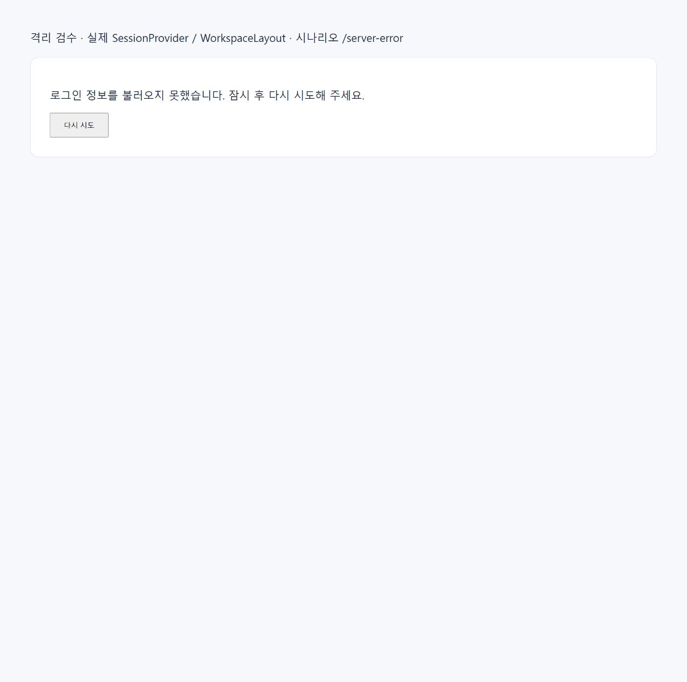

# 검수 및 dev 검토 가이드

## 검수 범위

실제 고객 데이터, 운영/개발 DB, 외부 메일·알림톡·Google Chat 발송을 사용하지 않았다. 단위 테스트는 가상 응답을 사용한다. DB 재현은 임시 loopback PostgreSQL, 발송 검수는 PGlite와 가상 발송 클라이언트, 브라우저 검수는 실제 세션 컴포넌트와 가상 API를 사용했다.

| 검사 | 결과 / 근거 |
| --- | --- |
| 전체 단위 테스트(Node 24, concurrency 2) | 최종 실행 1,435개: **1,434 통과, 실패 0, 기존 조건부 PostgreSQL 전자서명 검사 1 skip**, 종료 코드 0, 89.54초. 앞선 실행의 collector 타이밍 실패는 단독 재검 및 마지막 전체 실행 모두 통과 |
| 세션·검색·DB 설정·기존 상담 전환 검사 | 대상 검사 통과. 전체 실행에서도 관련 실패 없음 |
| 워커 잠금 | 4개 통과: 연결 한도·중복 작업, 획득 실패 정리, 종료 실패 시 한도 유지, FIFO 공정성 |
| 실제 PostgreSQL | 30만 건의 결과 동일성·실행 계획, 인덱스 반복 실행·INVALID 복구·경합·재시도, SQL timeout 복구, 공용 풀 고갈 재현, 분리 후 조회 진행 검증 통과 |
| 랜덤 발송 회귀 검수 | 1,010개 가상 레코드, 이틀에 걸쳐 40개 사전 준비, 외부 요청 0. 예약 전 발송 없음, 다음 날 재분산, 지연 시 몰아 보내지 않음, 수신거부 반영, 중복 선점·불명확 전송 결과 보호 통과 |
| TypeScript | `pnpm exec tsc --noEmit` 통과 |
| 새 핵심 코드 정적 검사 | ESLint 대상 11개 파일 통과 |
| CloudType 배포 빌드 | Node 24.19.0 / pnpm 10.15.0에서 `pnpm run build:cloudtype` 종료 코드 0. 컴파일·타입 검사·정적 페이지 225개 생성·standalone 산출물 및 마이그레이션 116개 포함 확인 |
| 브라우저 | 아래 네 시나리오 모두 관찰 |

전체 테스트에서 skip한 전자서명용 원격 PostgreSQL 통합 검사를 이번 장애의 DB 검증으로 대체했다고 주장하지 않는다. 이번 변경의 DB 동작은 별도의 실제 PostgreSQL 스크립트로 검사했다.

## 브라우저 검수

`node scripts/incident-session-ui.cjs` 실행 후 로컬 Chrome에서 확인했다. 실제 `SessionProvider`와 `WorkspaceLayout`을 번들링하고 next router와 화면 shell만 가상 구현으로 대체한다. 고객 상담 전체를 검수하는 서버는 아니다.

| 주소 | 최초 응답 | 확인 결과 |
| --- | --- | --- |
| `http://127.0.0.1:3119/server-error` | 503 | 오류 안내와 다시 시도 표시 → 클릭 후 가상 상담 화면 복구 |
| `http://127.0.0.1:3119/slow` | 응답 헤더 지연 | 로딩 후 제한 시간 경과 시 안내 → 다시 시도로 복구 |
| `http://127.0.0.1:3119/body-stall` | 헤더는 성공, JSON 본문 정지 | 본문에도 시간 제한 적용 → 다시 시도로 복구 |
| `http://127.0.0.1:3119/unauthorized` | 401 | `/login?next=%2Funauthorized` 이동 요청 |

15초 경계는 실제 helper의 기본값을 사용하며, 단위 테스트에서는 짧은 제한을 주어 헤더/본문 abort를 별도 검증한다. 브라우저는 전후 화면 관찰이며 정밀한 15초 타이밍 계측 결과가 아니다.




## 재현 명령

프로젝트 배포 환경과 맞춘 Node 24, lockfile의 pnpm 10.15.0을 사용한다.

```powershell
pnpm install --frozen-lockfile
pnpm exec tsx --test --test-concurrency=2 "src/**/*.test.ts"
pnpm exec tsc --noEmit
node scripts/check-random-email-schedule.cjs
node scripts/incident-session-ui.cjs
```

DB 실험에는 PostgreSQL 실행 파일이 필요하다. 기존 개발/운영 DB를 사용하지 않는다. Windows에서는 임시 디렉터리가 ASCII 경로인지 확인한다. 스크립트는 Node `os.tmpdir()` 아래 지정한 디렉터리만 허용한다. 기존 시험 서버가 실행 중이라면 중복 시작하지 않는다.

```powershell
$qaData = Join-Path ([IO.Path]::GetTempPath()) 'sendb-incident-20261023-pg'
# 처음 생성하는 경우에만 실행한다.
initdb -D $qaData -U sendb_incident_qa -A trust --encoding=UTF8 --no-locale
pg_ctl -D $qaData -l (Join-Path $qaData 'server.log') -o '-h 127.0.0.1 -p 55623 -c max_connections=30' -w start
pnpm exec tsx scripts/check-incident-db.ts
pg_ctl -D $qaData -m fast -w stop
```

결과는 `.testenv/incident-db-evidence.json`에 남는다. 스크립트가 자체 생성한 무작위 DB는 종료 시 제거하고, 클러스터 디렉터리는 자동 삭제하지 않는다. 이번 검수의 임시 PostgreSQL과 UI 서버는 검수 후 종료했다. 최종 검사 요약은 [qa-summary.json](evidence/qa-summary.json)에 보존했다.

빌드는 실제 서비스 환경 파일 없이 가상 주소로 실행한다. 아래 설정은 이 검수 셸에서만 사용한다.

```powershell
$env:DATABASE_URL = 'postgresql://sendb_build_fixture@127.0.0.1:9/sendb_build_fixture'
$env:JWT_SECRET = 'isolated-build-fixture-not-for-any-deployment'
$env:NEXT_PUBLIC_APP_URL = 'https://port-next-sendb-dev-1ru12mlw8nvyar.sel5.cloudtype.app'
$env:NEXT_PUBLIC_BASE_URL = 'http://127.0.0.1:3119'
pnpm run build:cloudtype
```

## 검토 순서

1. [조사 보고서](REPORT.md)의 사실/추정 구분과 타임라인을 확인한다. 특히 13:45 복구 보고와 15:33 수정 병합은 서로 다른 시각이다.
2. `db/schema.ts`, `db/send-log-indexes.ts`, `email/logs/route.ts`의 인덱스 정의와 정확 검색을 본다. SQL 트랜잭션으로 인덱스 생성이 이동하지 않았는지 확인한다.
3. `db/worker-lock.ts`와 호출하는 8개 워커를 본다. 기존 잠금 키·업무 선점 SQL·실제 발송 내용은 유지하고 잠금 연결 수명만 바꿨다. DB 총 연결 한도에는 프로세스당 추가 4개를 반영해야 한다.
4. `SessionContext`, `WorkspaceLayout`, `session-request`는 main의 기존 복구 변경과 일치하는지 확인한다.
5. main/dev에는 이 변경 외의 기능 차이도 있으므로 전체 dev를 자동 병합하지 않는다. 운영 반영은 별도 검토·배포 범위다. 인덱스는 additive이며 이 커밋을 되돌릴 때 운영 인덱스를 자동 삭제하지 않는다.

## 검수 중 환경 문제 기록

최종 빌드는 F 드라이브의 격리 복사본에서 수행했다. `src/`, `scripts/`, `public/`, `drizzle/` 및 빌드 설정·lockfile의 총 1,841개 파일을 원본 작업 트리와 SHA-256 비교해 불일치가 없음을 확인했다. 실제 배포 비밀 설정은 사용하지 않았다.

- 시스템 기본 Node 25.8.1에서는 기존 전자서명 build 스크립트가 native 종료 코드 3221226505로 중단됐다. 같은 소스의 해당 단계는 Node 24.19.0에서 통과했다. 이번 수정의 제품 코드로 이 환경 차이를 우회하지 않았다.
- C 드라이브가 가득 차 Next webpack 캐시 쓰기가 ENOSPC로 실패했다. 이번 작업에서 생성한 `.next`만 정리하고 F 드라이브 임시 복사본으로 검증을 옮겼다. 사용자 원본 파일은 삭제하지 않았다.
- C 드라이브 node_modules를 F 드라이브에 junction으로 연결하면 Windows Next 빌드가 드라이브 간 경로를 해석하지 못했다. F 임시 복사본에 동일 lockfile로 의존성을 설치해 해결했다.
- 첫 전체 실행의 collector 40ms 검사는 동시 파일 I/O 중 실패했다. 단독 실행과 빌드·복사가 끝난 뒤의 마지막 전체 실행에서 통과했다. 이 관찰만으로 제품 장애 원인이나 테스트의 영구 안정성을 주장하지 않는다.
